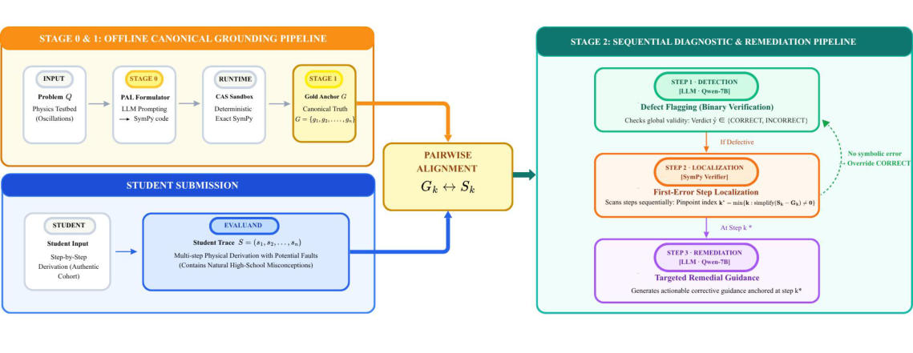

# A Neuro-Symbolic Physics AI Tutor — Benchmark & Code

Dataset, prompt templates, response logs, and reproducibility scripts for our work on
LLM-based high-school physics tutoring. The project pairs a constrained Chain-of-Thought
(CoT) reasoner with **PAL-style tool use** and a **SymPy step-verifier**, turning an
unreliable LLM grader into a trustworthy neuro-symbolic tutor.



---

## Overview

Under a constrained CoT paradigm, an open model (Qwen2.5-7B) reasons well about physics
(reasoning index 96.7%) yet its exact-match accuracy collapses to 33.3% on variants with
irrational constants such as π and √2 — a pure **arithmetic** failure, not a reasoning one.
We close this with a three-stage pipeline:

- **Stage 0 — PAL Symbolic Solver.** The LLM emits a `def solution()` executed in a
  deterministic SymPy sandbox, so numbers come from the interpreter, not the transformer.
  This restores **100%** arithmetic accuracy over a fully audited 154-step trace.
- **Stage 1 — Pedagogical Verbalizer.** Each verified trace becomes a canonical
  three-step gold anchor (Theory → Formula/Substitution → Conclusion).
- **Stage 2 — Diagnostic Tutor.** An LLM flags defects (Step 1), a SymPy step-verifier
  localizes the first error via `simplify(S_k - G_k) = 0` and overrides false verdicts
  (Step 2), then the LLM writes remediation anchored at that step (Step 3).

**Key results (balanced 62-submission benchmark).** The LLM grader alone is
high-sensitivity (96.8%) but low-specificity (48.4%), wrongly rejecting 16 of 31 correct
submissions. Adding the SymPy step-verifier raises specificity to 96.8% and accuracy to
98.4%, and lifts first-error localization from 43.3% to 100%.

---

## Repository Structure

```text
.
├── assets/
│   └── pipeline.png                          # Neuro-symbolic three-stage pipeline diagram
│
├── Dataset/                                  # Inputs / curated data
│   ├── physics_testbed_curation.csv          # 442 curated Mechanical Oscillation problems
│   ├── stage1_gold_solutions_22.csv          # 22 canonical three-step gold anchors (Stage 1)
│   └── stage2_input_62.csv                   # Balanced 62-submission set (31 faulty / 31 correct)
│
├── Prompts/                                  # 40 constrained Chain-of-Thought prompt templates
├── Prompts_PAL/                              # 40 PAL (Program-Aided) Stage-0 prompt templates
│
├── Results/                                  # Model outputs, scores, audits
│   ├── foundational_testbed_40_results.csv   # All models on the 40 benchmark questions
│   ├── prompt_tuning_variants_80_results.csv # Outputs on the 80 prompt-tuning variants
│   ├── arithmetic_stress_test_450_results.csv# Qwen-7B on 450 stress-test variants
│   ├── stage0_pal_results_40.csv             # Stage 0 PAL solver results (40 questions)
│   ├── stage0_arithmetic_audit.csv           # 154-step SymPy audit trace (zero errors)
│   └── stage2_grading_worksheet.csv          # Expert grading of tutor feedback
│
├── Scripts/                                  # Reproducibility scripts
│   ├── run_qwen_inference.py                 # Qwen2.5-Instruct inference (interactive & batch)
│   ├── calculate_metrics.py                  # Accuracy, S_idx, C_rate
│   ├── calculate_stress_test.py              # Arithmetic stress-test accuracies
│   ├── symbolic_step_verifier.py             # Stage 2 SymPy step-verifier: simplify(S_k - G_k) = 0
│   ├── qwen_evaluation.py                    # Stage 0 PAL evaluation pipeline
│   ├── stage1_standard_solutions.py          # Stage 1 gold-solution generation
│   └── stage2_tutor_diagnostic.py            # Stage 2 diagnostic tutor pipeline
│
├── LICENSE
└── README.md
```

---

## Setup

Python 3.8+ is required. Metric scripts need only `pandas`/`numpy`; inference additionally
needs PyTorch and Hugging Face Transformers; the step-verifier needs `sympy`.

```bash
git clone https://github.com/duy23520375/Physics-LLM-Benchmark.git
cd Physics-LLM-Benchmark
pip install torch transformers pandas numpy sympy
```

---

## Reproducing Results

```bash
# Problem-solving performance (Accuracy, S_idx, C_rate)
python Scripts/calculate_metrics.py

# Arithmetic stress-test (Easy / Medium / Hard tiers)
python Scripts/calculate_stress_test.py

# Stage 0 — constrained-CoT inference / PAL evaluation
python Scripts/run_qwen_inference.py
python Scripts/qwen_evaluation.py

# Stage 2 — neuro-symbolic diagnostic tutor
python Scripts/stage2_tutor_diagnostic.py
python Scripts/symbolic_step_verifier.py
```

*Inference uses `torch.float16` by default for Kaggle/Colab T4 GPUs.*

---

## Citation

This repository accompanies our MAPR 2026 paper (IEEE). If you use the dataset, prompts,
or scripts, please cite:

> H. K. D. Nguyen and C. T. Nguyen, "A Preliminary Study on Building an LLM-Powered
> Physics AI Tutor for High School Students," in *2026 International Conference on
> Multimedia Analysis and Pattern Recognition (MAPR)*, IEEE, 2026.

```bibtex
@inproceedings{nguyen2026physicstutor,
  author    = {Nguyen, Huu Khanh Duy and Nguyen, Chinh Trong},
  title     = {A Preliminary Study on Building an {LLM}-Powered Physics {AI} Tutor for High School Students},
  booktitle = {2026 International Conference on Multimedia Analysis and Pattern Recognition (MAPR)},
  publisher = {IEEE},
  year      = {2026}
}
```
