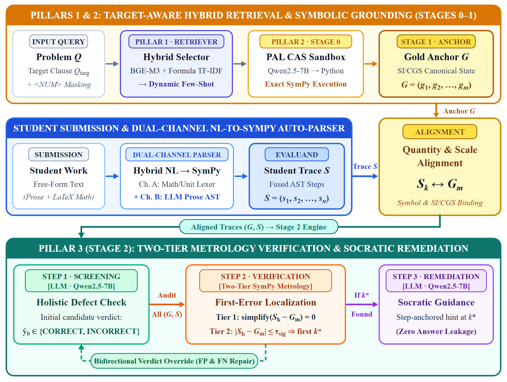
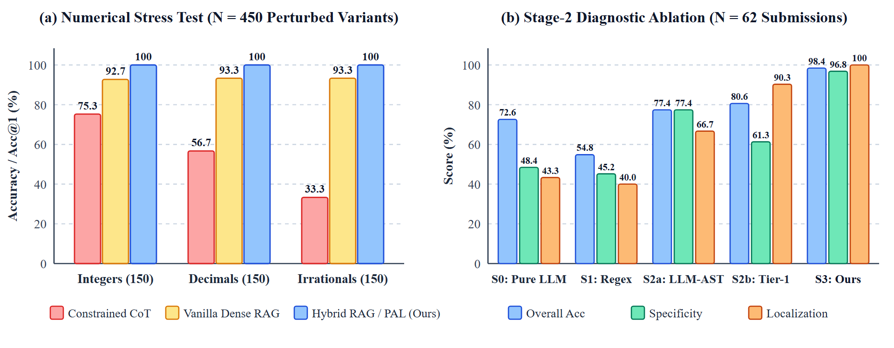
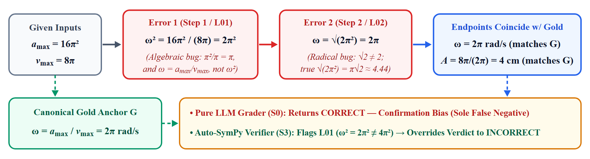

# A Chain-of-Thought Prompting and Tool-Use Framework for AI Physics Tutoring

[](https://www.python.org/)
[](https://www.sympy.org/)
[](https://huggingface.co/Qwen/Qwen2.5-7B-Instruct)
[](LICENSE)

Official dataset, prompt templates, neuro-symbolic solver/verifier pipelines, Kaggle/Colab notebooks, and evaluation logs for **"A Chain-of-Thought Prompting and Tool-Use Framework for AI Physics Tutoring"** (extending our preliminary feasibility benchmark at MAPR 2026).



---

## Overview

Deploying compact open-weight Large Language Models (`Qwen2.5-7B-Instruct`) as affordable, privacy-preserving on-premise high-school physics tutors faces three core bottlenecks:
1. **Surface-form retrieval fragility** when dense/sparse retrievers match shared oscillator setups or literal numbers rather than the queried physical law;
2. **Autoregressive arithmetic drift** on coupled equations with irrational constants ($\pi, \sqrt{2}, \sqrt{3}$), where pure Chain-of-Thought (CoT) exact-match accuracy drops from **75.3%** (integers) to **33.3%** (irrationals); and
3. **Diagnostic grading unreliability**, where pure LLM-as-a-Judge graders suffer confirmation bias on compensating double errors while over-rejecting valid student derivations written in alternative algebraic forms, CGS units, or rounded decimals (**48.4%** specificity).

We resolve all three bottlenecks through a unified **three-pillar neuro-symbolic architecture**:

- **Pillar 1 — Target-Aware Hybrid Dynamic Retriever:** Combines physics symbol canonicalization, `<NUM>` constant masking, terminal Vietnamese interrogative target-clause isolation ($Q_{\mathrm{targ}}$), and multi-view `BGE-M3` + character/word n-gram `TF-IDF` fusion across $K=40$ canonical sub-skill templates (**99.17% Acc@1**, **100.0% Acc@3**, and **100.0% invariance** across 450 numerical perturbations at **35.7 ms/query**).
- **Pillar 2 — Exact PAL Symbolic Solver & Verbalizer (Stages 0–1):** Synthesizes exact rational/radical `SymPy` programs (`sp.Rational`, `sp.pi`, `sp.sqrt`, `sp.solve`) executed in a deterministic CAS sandbox to achieve **100.0% accuracy** across both textbook (`Foundational-40`, **154/154** audited symbolic statements) and irrational stress tiers (`Stress-450`), harvesting canonical SI/CGS state anchors $G$ to ground **Theory–Calculation–Conclusion** derivations.
- **Pillar 3 — Automated Dual-Channel Parser & Two-Tier Metrology Verifier (Stage 2):** Compiles free-form Vietnamese student prose and LaTeX equations into **1,079** fused `SymPy` syntax trees via **Channel A** (deterministic math/unit lexer, **96.37%** compile rate) and **Channel B** (`Qwen2.5-7B` JSON prose AST extractor, **100%** compile rate). A **Two-Tier Metrology Verifier** separates **Tier-1 exact algebraic identity** (`simplify = 0`) from **Tier-2 precision-adaptive rounding & CGS/SI scaling** ($\tau_{\mathrm{sig}}$) with a **Bidirectional Verdict Override**, anchoring non-leaky Socratic hints at the exact first faulty step $k^*$.

---

## Key Empirical Results



| Pillar & Benchmark | Baseline | Proposed Neuro-Symbolic Framework | Statistical Significance |
| :--- | :---: | :---: | :---: |
| **Pillar 1:** `All-120` Template Retrieval (`Acc@1` / `MRR`) | 94.17% / 96.00% (`BGE-M3` Raw) | **99.17%** / **99.58%** (`BGE-M3` Target-Aware Hybrid) | Paired Wilcoxon $p = 0.0086$ |
| **Pillar 1:** `Stress-450` Perturbation Invariance (`Acc@1`) | 93.11% (`BGE-M3` Raw, 31 drifts) | **100.00%** (450/450 across Int / Dec / Irr) | Margin $0.1264 \to \mathbf{0.3339}$ |
| **Pillar 2:** `Foundational-40` / `Stress-450` Irrationals | 95.0% / 33.3% (`Qwen2.5-7B` CoT) | **100.0%** / **100.0%** (`PAL SymPy`, 154/154 steps) | Zero arithmetic drift |
| **Pillar 3:** Stage-2 Diagnostic Accuracy ($N=62$) | 72.6% (`S0` Pure LLM, Spec 48.4%) | **98.4%** (`S3` Dual-Ch. + Two-Tier, Spec **96.8%**) | Exact McNemar $p = 0.000145$ |
| **Pillar 3:** First-Error Localization & Unseen Even Split | 43.3% Loc / 74.1% Unseen Acc | **100.0%** Loc (31/31) / **100.0%** Unseen Acc (27/27) | Unseen split $p = 0.0156$ |
| **Blind Human Study ($N=31$):** Faithfulness / Usefulness (1–3) | 41.9% / $1.45 \pm 0.57$ (`S0`) | **77.4%** / **$2.42 \pm 0.67$** (`S3`: 25W / 5T / 1L) | Wilcoxon $p = 9.0 \times 10^{-6}$ |

### Qualitative Case Study: Defeating Confirmation Bias (`sub_02`)


---

## Repository Structure

```text
Physics-LLM-Benchmark/
│
├── assets/                                              # Architecture & empirical figures
│   ├── fig1_architecture.png                            # Three-pillar neuro-symbolic architecture
│   ├── fig2_empirical_summary.png                       # Stress-450 invariance & Stage-2 ablation charts
│   ├── fig3_confirmation_bias.png                       # Compensating double-error audit (sub_02)
│   └── pipeline.png                                     # Stage 0-2 overview diagram
│
├── Dataset/                                             # Curated benchmarks & student-proxy cohort
│   ├── physics_testbed_curation.csv                     # 442 Grade-11 Mechanical Oscillation problems
│   ├── stress_test_450_template_mapping.csv             # 450 numerical variants mapped to K=15 templates
│   ├── stage1_gold_solutions_22.csv                     # 22 Stage-1 canonical gold derivations
│   └── stage2_input_62.csv                              # 62 multi-step derivations (31 faulty + 31 correct)
│
├── Prompts/                                             # 40 Constrained Chain-of-Thought sub-skill templates
├── Prompts_PAL/                                         # 40 PAL Symbolic Solver (Stage-0 SymPy) templates
│
├── Results/                                             # Logged outputs, ablations, & blind human ratings
│   ├── pillar1_backbone_comparison.csv                  # Table 1: Lexical vs. Dense vs. Target-Aware Hybrid
│   ├── pillar1_latency_overhead.csv                     # Table 1: Per-query encoding & hybrid fusion latency
│   ├── pillar1_ablation_study.csv                       # Table 1: BGE-M3 ablation (M0 -> M1 -> M2 -> M3 -> M4)
│   ├── pillar1_stress_test_450_summary.csv              # Table 1: Stress-450 invariance & similarity margins
│   ├── pillar1_predictions_120.csv                      # Per-query retrieval predictions on All-120
│   ├── pillar1_retrieval_full_evaluation.xlsx           # Full 7-sheet Pillar 1 evaluation workbook
│   ├── foundational_testbed_40_results.csv              # Table 2: 5-model forward outputs on Foundational-40
│   ├── prompt_tuning_variants_80_results.csv            # Paraphrased/context-shifted Variants-80 outputs
│   ├── arithmetic_stress_test_450_results.csv           # Table 2: Qwen2.5-7B CoT outputs on Stress-450
│   ├── stage0_pal_results_40.csv                        # Table 2: Pillar 2 PAL SymPy outputs (40/40 = 100%)
│   ├── stage0_arithmetic_audit.csv                      # 154-step SymPy execution audit trace (zero errors)
│   ├── pillar3_stage2_system_ablation.csv               # Table 3: 5-system diagnostic ablation (S0-S3)
│   ├── pillar3_stage2_question_disjoint_split.csv       # Table 3: Calibration (Odd) vs. Unseen Test (Even)
│   ├── pillar3_stage2_diagnostics_62.csv                # Per-submission AST counts, verdicts & localizations
│   ├── pillar3_blind_human_evaluation_31.csv            # Table 4: 50/50 blinded human evaluation (N=31)
│   ├── pillar3_stage2_full_evaluation.xlsx              # Full 9-sheet Pillar 3 & blind study workbook
│   └── stage2_grading_worksheet.csv                     # Preliminary rubric worksheet
│
├── Scripts/                                             # Reproducible CLI pipelines & metric verifiers
│   ├── reproduce_paper_tables.py                        # Instant (<2s CPU) verifier for Tables 1, 2, 3, & 4
│   ├── pillar1_hybrid_retrieval.py                      # Pillar 1: Target-Aware Hybrid Retriever & ablations
│   ├── qwen_evaluation.py                               # Pillar 2 (Stage 0): PAL SymPy symbolic solver
│   ├── stage1_standard_solutions.py                     # Pillar 2 (Stage 1): Constrained verbalizer
│   ├── pillar3_autosympy_verifier.py                    # Pillar 3 (Stage 2): Dual-Channel + Two-Tier Verifier
│   ├── symbolic_step_verifier.py                        # Minimal standalone SymPy equivalence demo
│   ├── stage2_tutor_diagnostic.py                       # Pure LLM baseline grader (S0)
│   ├── run_qwen_inference.py                            # Constrained CoT batch/interactive inference
│   ├── calculate_metrics.py                             # Baseline Accuracy, S_idx, and C_rate calculator
│   └── calculate_stress_test.py                         # Baseline Stress-450 tier calculator
│
├── Notebooks/                                           # Self-contained 1-click Kaggle / Colab notebooks
│   ├── Pillar1_Hybrid_Retrieval_Benchmark.ipynb         # Full Pillar 1 retrieval & perturbation benchmark
│   └── Pillar3_Stage2_AutoSymPy_Verifier.ipynb          # Full Pillar 3 Stage-2 & blind study benchmark (T4 GPU)
│
├── LICENSE                                              # MIT License
└── README.md
```

---

## Quick Start & Reproducing Paper Results

### 1. Environment Setup

```bash
git clone https://github.com/duy23520375/Physics-LLM-Benchmark.git
cd Physics-LLM-Benchmark

# Core dependencies for instant table/statistical verification & symbolic checks (CPU-only)
pip install numpy pandas scipy sympy openpyxl

# Full GPU dependencies for running dense encoders & Qwen2.5-7B-Instruct inference
pip install torch transformers accelerate sentence-transformers scikit-learn rank-bm25 matplotlib
```

### 2. Instant Verification of All Paper Tables & Statistical Tests (< 2s on CPU)

To recompute every metric, confusion matrix, AST compilation count, exact McNemar $p$-value, and paired Wilcoxon test across **Tables 1–4** directly from the logged benchmark outputs:

```bash
python Scripts/reproduce_paper_tables.py
```

### 3. Running Individual Pillars End-to-End

```bash
# Pillar 1 — Target-Aware Hybrid Retrieval across 6 encoders, M0-M4 ablations, & Stress-450
python Scripts/pillar1_hybrid_retrieval.py

# Pillar 2 — Constrained CoT baselines & PAL Stage-0 SymPy symbolic solver + Stage-1 verbalizer
python Scripts/calculate_metrics.py
python Scripts/calculate_stress_test.py
python Scripts/qwen_evaluation.py
python Scripts/stage1_standard_solutions.py

# Pillar 3 — Dual-Channel NL-to-SymPy Parser, Two-Tier Metrology Verifier, & Socratic Tutor (GPU)
python Scripts/pillar3_autosympy_verifier.py

# Standalone minimal SymPy step-equivalence demonstration (CPU)
python Scripts/symbolic_step_verifier.py
```

Alternatively, open [`Notebooks/Pillar1_Hybrid_Retrieval_Benchmark.ipynb`](Notebooks/Pillar1_Hybrid_Retrieval_Benchmark.ipynb) or [`Notebooks/Pillar3_Stage2_AutoSymPy_Verifier.ipynb`](Notebooks/Pillar3_Stage2_AutoSymPy_Verifier.ipynb) directly on **Kaggle (Tesla T4 GPU)** or **Google Colab** (`temperature=0`, `torch.float16`).

---

## Citation

If you use our benchmark corpus, templates, symbolic verifier, or evaluation logs in your research, please cite:

```bibtex
@inproceedings{nguyen2027neurosymbolic,
  author    = {Nguyen, Huu Khanh Duy and Nguyen, Chinh Trong},
  title     = {A Chain-of-Thought Prompting and Tool-Use Framework for {AI} Physics Tutoring},
  booktitle = {Proceedings of the 2027 12th International Conference on Intelligent Information Technology (ICIIT 2027)},
  publisher = {ACM},
  address   = {New York, NY, USA},
  year      = {2027}
}

@inproceedings{nguyen2026physicstutor,
  author    = {Nguyen, Huu Khanh Duy and Nguyen, Chinh Trong},
  title     = {A Preliminary Study on Building an {LLM}-Powered Physics {AI} Tutor for High School Students},
  booktitle = {Proceedings of the 9th International Conference on Multimedia Analysis and Pattern Recognition (MAPR)},
  publisher = {IEEE},
  pages     = {55--60},
  year      = {2026},
  doi       = {10.1109/mapr72750.2026.11685761}
}
```

## License

This project is released under the [MIT License](LICENSE).
